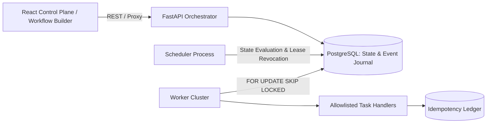

# ⚡ Self-Healing Distributed Workflow Engine
-> Live at :https://self-healing-workflow-engine.vercel.app/

A production-grade, fault-tolerant DAG (Directed Acyclic Graph) workflow engine and management console built with Python (FastAPI), React, and PostgreSQL. Designed for high availability, transactional worker locking, smart retry/recovery mechanisms, and strict idempotency guarantees.

---

## 🌟 Key Highlights & Engineering Features

* **Transactional Task Claiming:** Utilizes PostgreSQL `FOR UPDATE SKIP LOCKED` row-level locking to allow multiple worker nodes to claim work concurrently without race conditions or lock contention.
* **Self-Healing Lease Recovery:** A distributed scheduler detects expired worker leases (e.g., node crashes or network partitions), automatically revoking leases and re-queuing orphaned tasks.
* **Declarative DAG Validation:** Accepts JSON workflow definitions and performs static analysis to validate schemas, resolve dependencies, detect cycles, and enforce size limits.
* **Idempotency & Event Journaling:** Implements an operation ledger ensuring safe retries under an *at-least-once* execution model. Every state transition and attempt is fully audited.
* **Interactive Control Plane:** React + Vite frontend featuring a JSON Workflow Builder, live task/run tracking dashboard, and an evidence-backed **Demo & Reliability Lab** for stress testing state recovery.

---

## 🏗️ Architecture Overview



---

## 🛠️ Tech Stack

* **Backend:** Python 3.12, FastAPI, SQLAlchemy (Async/Sync), Alembic, Pydantic, PostgreSQL, SQLite.
* **Frontend:** React, Vite, Tailwind CSS, Nginx.
* **DevOps & Cloud:** Docker Compose, AWS ECS Fargate, AWS RDS, CloudFormation, PowerShell automation.
* **Testing & Tooling:** Pytest, Ruff, PNPM, Playwright/Vitest.

---

## 🚀 Quick Start (Docker Compose)

Spin up the full multi-container stack (PostgreSQL, DB migrations, API, Scheduler, Worker, and Nginx UI) in seconds:

```powershell
# Copy environment variables
Copy-Item .env.example .env

# Build and start services in detached mode
docker compose up --build -d
```

* **Control Plane UI:** [http://localhost:5173](http://localhost:5173)
* **API Documentation:** [http://localhost:8000/docs](http://localhost:8000/docs)
* **Health Endpoint:** [http://localhost:8000/health/ready](http://localhost:8000/health/ready)

## Using Neon PostgreSQL

The backend uses PostgreSQL through SQLAlchemy's asyncpg driver. Copy the Neon connection URL from the Neon dashboard into `DATABASE_URL` in the local `.env` file. Standard `postgresql://` and `postgres://` URLs are supported; the backend converts them to `postgresql+asyncpg://` and maps Neon TLS options for asyncpg. Keep `.env` out of source control.

For a fresh Neon database, start the stack with `docker compose up --build -d`. Compose runs `alembic upgrade head` before starting the API, scheduler, or worker. Check `http://localhost:8000/health/ready` and `http://localhost:8000/api/v1/dashboard`; readiness should report `database: ready` and the dashboard should return JSON.

For Render, set the same `DATABASE_URL` in the backend service environment and run `alembic upgrade head` as a migration step before the API starts. After deploying, verify `/health/ready` before connecting the Vercel frontend. A Render service's local filesystem is ephemeral, so keep workflow state in Neon PostgreSQL rather than the default local SQLite file.

---

## 🧪 Local Development (Without Docker)

Requires Python 3.12+, Node 22+, and PNPM.

```powershell
# 1. Setup Backend Environment
python -m venv .venv
.\.venv\Scripts\Activate.ps1
python -m pip install -e '.[dev]'
$env:DATABASE_URL = 'sqlite+aiosqlite:///./workflow-local.db'
$env:ENVIRONMENT = 'development'
python -m alembic upgrade head

# 2. Run Backend Services (in separate terminals)
python -m backend.app           # API Server
python -m backend.app scheduler # Background Scheduler
python -m backend.app worker    # Task Worker

# 3. Run Frontend Development Server
Set-Location frontend
pnpm install --frozen-lockfile
pnpm dev -- --port 5191
```

---

## 🛡️ Reliability Lab & Quality Assurance

The system includes a dedicated test suite and acceptance scenario runner to verify system behavior under adverse conditions:

* **Fault Scenarios Tested:** Sequential dependencies, parallel task execution, automatic retries with exponential backoff, worker crash recovery, service restarts, and cooperative cancellation.

```powershell
# Run Unit & Integration Tests
python -m pytest

# Run Code Formatting & Lint Checks
python -m ruff check backend migrations scripts tests

# Run Frontend Tests & Production Build
Set-Location frontend
pnpm test
pnpm build
```

---

## 📂 Project Structure

```text
├── backend/            # FastAPI API, engine core, scheduler, workers, DB models
├── frontend/           # React application & production Nginx configuration
├── migrations/         # Alembic database schema migrations
├── tests/              # End-to-end, concurrency, and unit test suite
├── scripts/            # Packaging, benchmarking, and acceptance utilities
├── deploy/aws/         # CloudFormation templates for ECS Fargate & RDS
└── docs/               # System architecture & design specifications
```

---

## 📚 Documentation

* [Architecture & Design Details](docs/architecture.md)
* [Workflow Schema Specification](docs/workflow-definition-format.md)
* [Engine State Machine](docs/state-machine.md)
* [Reliability Lab Setup](docs/reliability-lab.md)
* [AWS Deployment Guide](deploy/aws/README.md)
