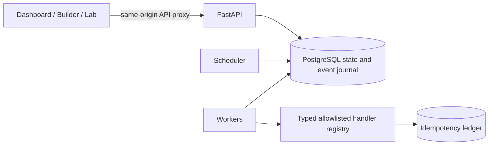

# Self-Healing Distributed Workflow Engine

A reusable, database-backed DAG workflow engine. Define workflows as JSON, choose from allowlisted task handlers, save versions, execute multiple isolated runs, and inspect persisted attempts and events. The React app includes a dynamic control plane, JSON Workflow Builder, and evidence-based Demo & Reliability Lab.

## Local setup (Docker Compose)

For the complete Windows and VS Code walkthrough, see [Local setup in VS Code](docs/vscode-local-setup.md).

Requires Docker Compose. In PowerShell:

```powershell
Copy-Item .env.example .env
docker compose up --build -d
docker compose ps
```

The Compose stack starts PostgreSQL, runs Alembic migrations, then starts the API, scheduler, worker, and production-built Nginx frontend. Open [http://localhost:5173](http://localhost:5173). API health is available at `http://localhost:8000/health/ready`; the frontend serves same-origin `/api/v1/...` through its Nginx proxy. Use `docker compose logs -f api scheduler worker frontend` if readiness is delayed.

In the app:

1. Open **Workflow Builder**, edit the starter JSON, and choose **Validate**.
2. Choose **Save definition**, then **Run saved workflow**.
3. Inspect task outputs, retry history, timestamps, lease data, and chronological events in the control plane.
4. Open **Demo & reliability lab** to run persisted acceptance scenarios.

`Run preview workflow` remains a convenient order-processing demo. It is not the only workflow entry point.

## Architecture



Definitions are size-bounded and validated for handler schemas, unique keys, dependencies, and cycles. Saving an edit creates a definition version; every run snapshots its definition. The scheduler advances tasks only after dependencies succeed, persists retry deadlines, cancels pending work, and recovers expired leases. PostgreSQL workers claim with `FOR UPDATE SKIP LOCKED`, execute outside the claim transaction, then finalize only while holding the current lease token. See [architecture](docs/architecture.md) and [state machine](docs/state-machine.md).

## Custom workflows and handlers

Use the **Workflow Builder** JSON editor to create, validate, save, version, duplicate, and run definitions. No user-supplied code executes. The registry returns descriptions and input JSON Schemas from `GET /api/v1/task-types`. It includes `demo.generate_data`, `demo.validate_data`, `demo.transform_data`, `demo.summarize_data`, `demo.http_simulation` (simulated; it does not make a network request), `demo.delay`, `demo.echo`, `demo.fail_once`, `demo.fail_n_times`, `demo.permanent_failure`, and the order/payment demo handlers.

Handlers receive validated input and `context["dependencies"]`, a mapping of dependency task keys to persisted outputs. For example, `demo.transform_data` consumes the numeric `data` returned by `demo.generate_data`; `demo.summarize_data` consumes the transformed output. Each task has a timeout, attempt limit, retry strategy (`fixed` or `exponential`), base interval, and maximum retry delay. See [workflow-definition-format](docs/workflow-definition-format.md).

Useful endpoints are documented in the API's OpenAPI page at `http://localhost:8000/docs`. The versioned API supports workflow validation/catalog/version/duplicate/safe-delete, runs, tasks, attempts, events, dashboard statistics, and lab scenarios. Legacy unversioned routes remain for the original seed scripts.

## Local development without Docker

Requires Python 3.12+, Node 22+, and pnpm. Use SQLite for isolated single-process development:

```powershell
python -m venv .venv
.\.venv\Scripts\Activate.ps1
python -m pip install -e '.[dev]'
$env:DATABASE_URL = 'sqlite+aiosqlite:///./workflow-local.db'
$env:ENVIRONMENT = 'development'
python -m alembic upgrade head
```

In separate terminals, run:

```powershell
python -m backend.app
python -m backend.app scheduler
python -m backend.app worker
```

From `frontend`, run `pnpm install --frozen-lockfile` and `pnpm dev -- --port 5191`. Vite proxies `/api` to `http://localhost:8000` by default; set `VITE_API_PROXY_TARGET` to override it. SQLite worker concurrency is clamped to one task in a process, and only one SQLite worker process should run. Use PostgreSQL for multi-worker concurrency and recovery guarantees. The dashboard, builder, and lab are all backed by the selected API/database.

## Deploy to AWS

The [end-to-end AWS deployment guide](deploy/aws/README.md) covers credentials, prerequisites, optional TLS, deployment, verification, updates, troubleshooting, cost management, and teardown. The PowerShell script builds and pushes images to ECR, runs database migrations in a one-off task, and starts web, scheduler, and worker services.

## Project layout

```text
backend/             FastAPI API, workflow engine, handlers, database models
frontend/            React/Vite application and production Nginx container
migrations/          Alembic schema history
tests/               Backend reliability and API tests
scripts/              Seed, benchmark, acceptance, packaging utilities
deploy/aws/           ECS Fargate + RDS CloudFormation and deployment guide
docs/                 Architecture, state, workflow format, testing, reliability
Dockerfile            Production backend image
docker-compose.yml    Local PostgreSQL + API + scheduler + worker + UI
pyproject.toml        Python dependencies and tooling configuration
```

## Reliability lab and test commands

The lab checks persisted run snapshots, tasks, attempts, timestamps, events, and payment ledger rows. It covers sequential dependencies, actual parallel overlap, automatic retry, permanent failure and skipped descendants, idempotency, concurrent-run isolation, cancellation, worker crash recovery, and service restart recovery. PostgreSQL-only or operator-driven behavior is reported `INCONCLUSIVE` until evidence exists. Details and procedures are in [docs/reliability-lab.md](docs/reliability-lab.md).

```powershell
python -m pytest
python -m ruff check backend migrations scripts tests
Set-Location frontend
pnpm test
pnpm build
Set-Location ..
python scripts/package.py
```

`scripts/package.py` creates `self-healing-workflow-engine-aws-ready.zip`, checks its required source and AWS deployment files plus secret/cache exclusions, verifies ZIP integrity, extracts it into a temporary directory, applies migrations to a fresh SQLite database, and runs the backend suite from that extracted copy.

With an isolated API/scheduler/worker stack running, `make acceptance` invokes the API-driven scenario runner and writes raw results to `artifacts/reliability-results.json`. `make benchmark` runs the default sequential benchmark; see [testing](docs/testing.md) and [benchmark details](docs/benchmark-results.md). The PostgreSQL concurrency test uses `WORKFLOW_TEST_DATABASE_URL` and requires a dedicated test database with `test` in its name; test fixtures recreate its tables. Never point it at user data.

## Guarantees and limits

- Workflow state, run snapshots, attempts, task results, events, and the demo ledger are persisted in the database.
- PostgreSQL worker claims are row-locked; handlers execute at-least-once. Side effects require idempotency keys.
- The sample payment ledger uses a unique operation key and returns its prior result on retry. This is not exactly-once delivery to arbitrary providers.
- Cancellation is cooperative at task boundaries; external non-transactional work cannot be undone.
- SQLite is not a substitute for PostgreSQL concurrency testing. Worker-kill recovery, Compose health, and clean PostgreSQL migrations must be tested against PostgreSQL/Docker.
- Authentication, tenant isolation, quotas, arbitrary external connectors, and production operations hardening are outside this educational prototype.

## Documentation

- [Architecture](docs/architecture.md)
- [Workflow definition format](docs/workflow-definition-format.md)
- [State machine](docs/state-machine.md)
- [Reliability lab](docs/reliability-lab.md)
- [Testing](docs/testing.md)
- [Local setup in VS Code](docs/vscode-local-setup.md)
- [Benchmark results](docs/benchmark-results.md)
- [Generalization plan](docs/generalization-plan.md)
- [AWS deployment guide](deploy/aws/README.md)
