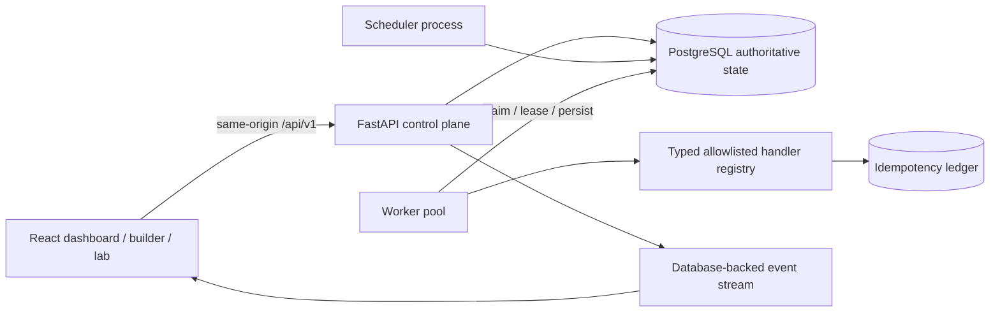

# Architecture

Workflow JSON is parsed and size-bounded, validated as a DAG, and checked against the handler registry's Pydantic input model. A saved definition is immutable in practice: editing creates a new row/version, and each run stores a JSON snapshot. Task rows copy the run-specific configuration, so old runs do not change when a later version is created.

The scheduler advances dependency states, retry deadlines, cancellations, and expired leases. PostgreSQL workers claim ready rows with `FOR UPDATE SKIP LOCKED`, create a persisted attempt and lease token, then execute a handler outside the claim transaction. Dependency outputs are loaded from completed task rows and passed as `context["dependencies"]`. A worker may commit a domain side effect before finalizing the task; stale lease tokens cannot finalize and side effects must provide idempotency keys.

SQLite is for isolated single-process development and tests. Worker concurrency is clamped to one task per SQLite worker process, but SQLite does not safely coordinate multiple worker processes. PostgreSQL remains the supported distributed execution store.

## API areas

- `/api/v1/task-types`: allowlisted handlers and JSON input schemas.
- `/api/v1/workflows`: create, list, inspect, validate, version, duplicate, and safely delete definitions.
- `/api/v1/workflows/{id}/runs`, `/api/v1/runs`: create and inspect durable run snapshots.
- `/api/v1/dashboard`: persisted aggregate counters and recent runs.
- `/api/v1/lab`: launch and evaluate persisted reliability scenarios.
- `/health/live`, `/health/ready`, `/api/v1/health`, `/metrics`: liveness, readiness, and metrics.
