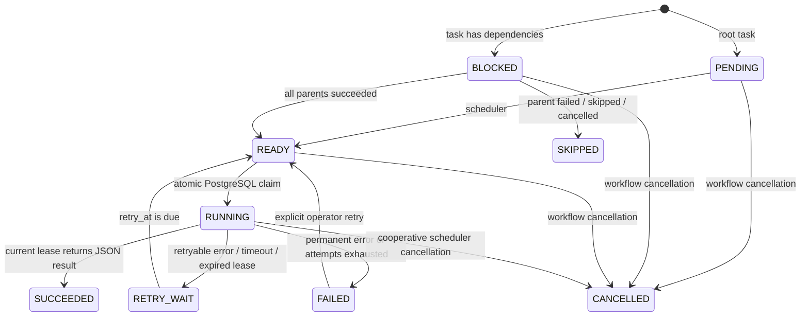

# State machine and reliability semantics

## Attempts, leases, and recovery

Every claim increments the persisted attempt count, inserts a unique `(task_id, attempt_number)` attempt, assigns a worker ID and random lease token, and records `task.started`. Heartbeats renew the lease. Only the worker holding the current token can finalize a task. Scheduler recovery records `task.lease_expired`, marks the attempt failed, and either schedules another attempt or permanently fails the task.

Failures are classified as `RETRYABLE`, `PERMANENT`, `TIMEOUT`, or `LEASE_EXPIRED`. Permanent handler errors bypass retry. Retry time is persisted, so a scheduler restart does not erase backoff. Explicit manual retry grants one additional attempt and resets skipped descendants to blocked/pending.

Workflow terminal aggregation occurs after scheduling: failed parents skip descendants, all-terminal workflows with any failure become `FAILED`, and a cancellation request prevents new claims and ends in `CANCELLED`. Async handlers such as `demo.delay` are cooperatively cancelled at their task boundary; arbitrary external blocking side effects cannot be rolled back.

Task execution is at-least-once. A handler may finish a side effect and lose its lease before persisting task success. External side effects therefore need a stable idempotency key. The payment demo enforces a unique ledger key and returns the stored result on retry; it does not prove exactly-once behavior for external payment providers.
